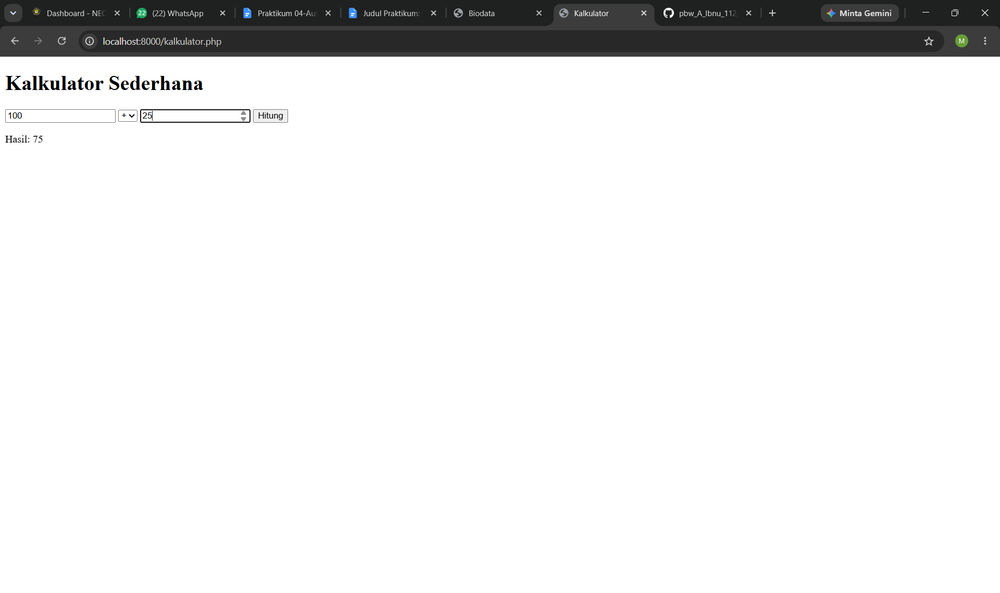
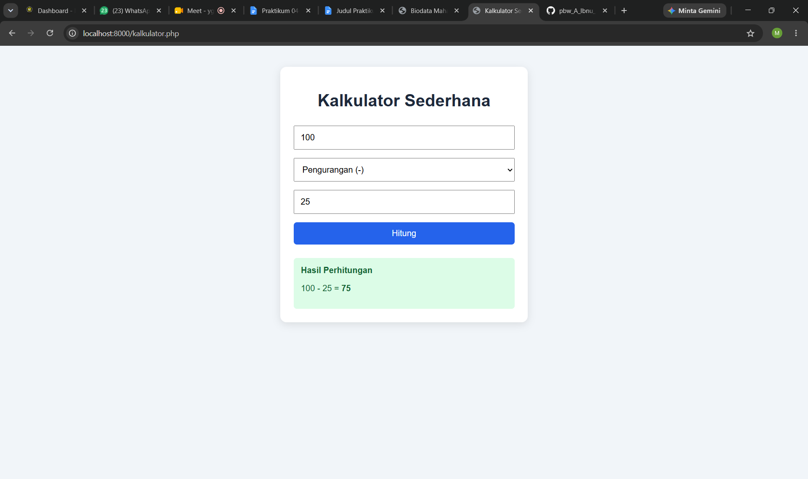
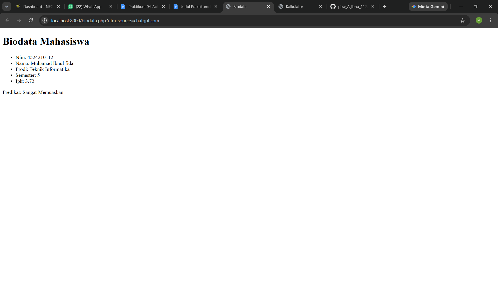
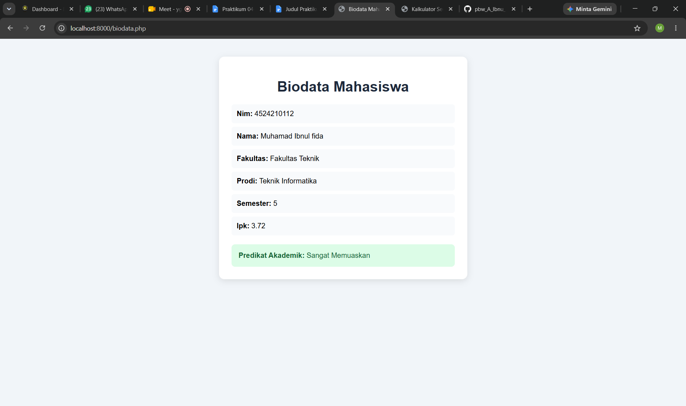

# Praktikum PBW 1

## 1. Kalkulator Sederhana

File: `kalkulator.php`

**Sebelum Modifikasi**

**Sesudah Modifikasi**

## 2. Biodata Mahasiswa

File: `biodata.php`

**Sebelum Modifikasi**

**Sesudah Modifikasi**

## 3. Modifikasi Program

Program kalkulator dan biodata berhasil dijalankan dan menampilkan hasil sesuai dengan fungsinya. Kalkulator dapat melakukan operasi aritmatika serta menampilkan pesan jika terjadi pembagian dengan nol. Biodata menampilkan informasi mahasiswa beserta predikat akademik.
## 4. Lima Bagian Kode Penting

1. **Variabel:** Menyimpan angka dan data mahasiswa.
2. **Switch-case:** Memilih operasi matematika pada kalkulator.
3. **Fungsi `statusKelulusan()`:** Menentukan predikat berdasarkan IPK.
4. **Foreach:** Menampilkan setiap data mahasiswa dari array.
5. **HTML dan CSS:** Membuat struktur halaman dan mengatur tampilannya.

## 5. Error dan Perbaikan

Tidak ada error saat program dijalankan. Kalkulator dan biodata berhasil ditampilkan sesuai fungsinya.