# Praktikum 6: Laravel & Filament (Manajemen Buku)

**Nama:** Muhamad Ibnul Fida

Aplikasi manajemen buku pakai Laravel 12, Filament 3.3, dan SQLite.

---

## Tugas 1: Implementasi Dasar

**Login ke admin panel berhasil**

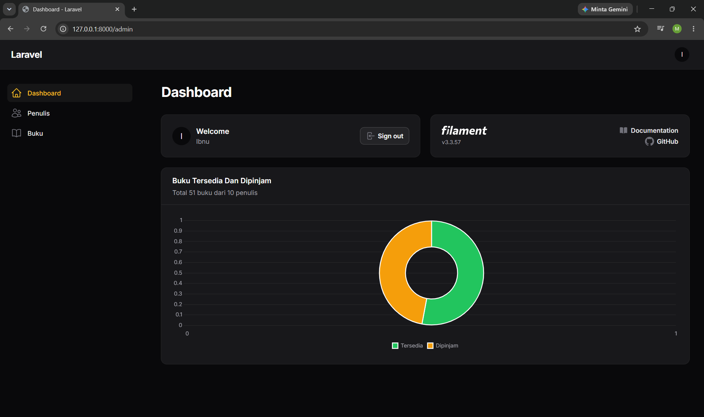

**List books dengan data hasil seeder**

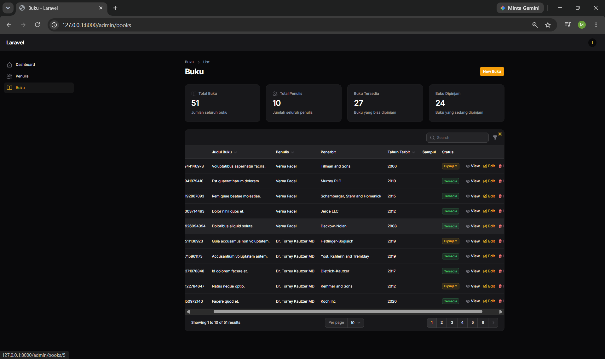

**Form create book**

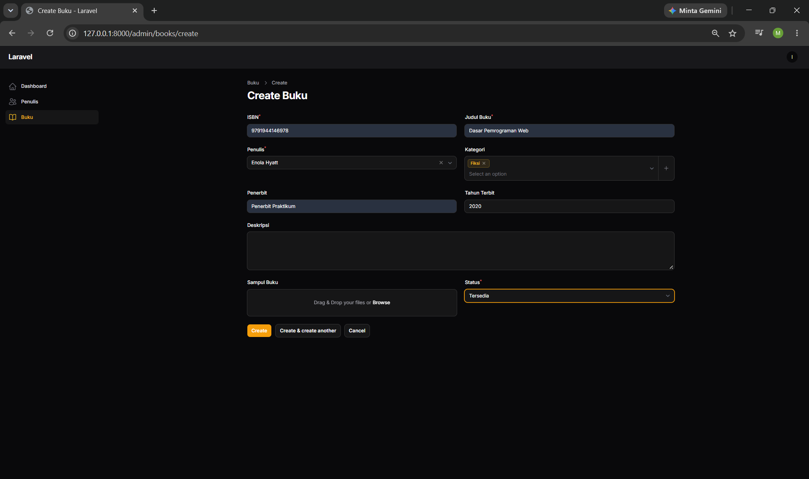

**Hasil pencarian**

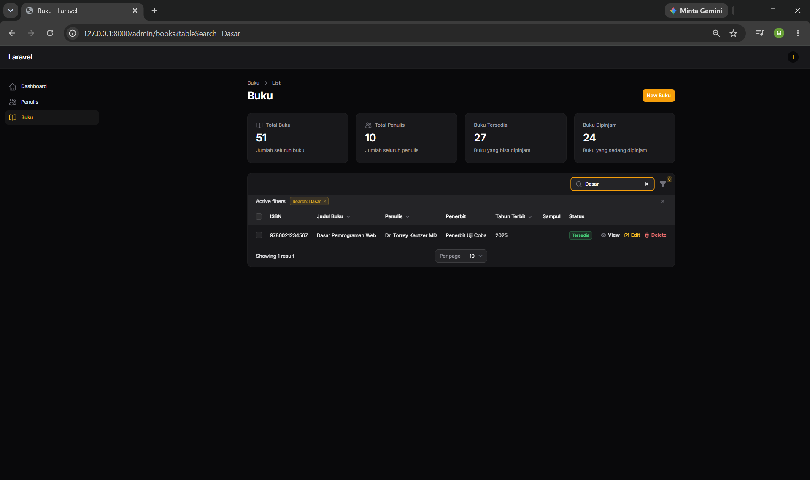

**Filter aktif**

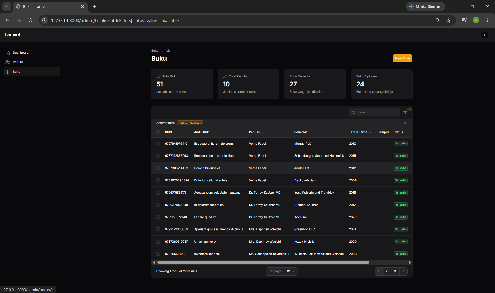

---

## Tugas 2: Kustomisasi dan Pengembangan

### 1. Field Description pada Book

Kolom `description` (text) ditambah lewat migration baru, dimasukkan ke `$fillable` di model Book, dipasang sebagai Textarea di form, dan diisi otomatis oleh factory pakai `fake()->paragraph()`.

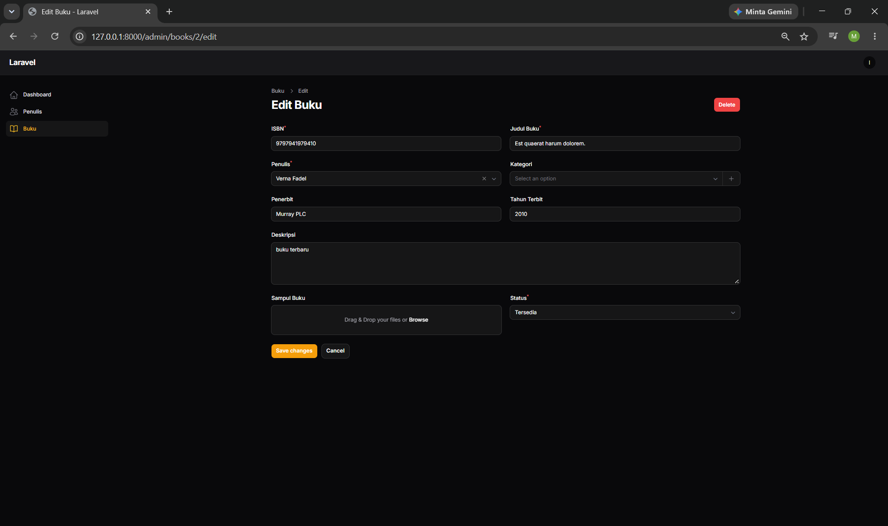

### 2. Role-Based Access

Tabel users ditambah kolom `role`. Akun admin, staff, dan viewer dibuat lewat `RoleUserSeeder`. Hak aksesnya diatur di `BookPolicy`:

- **Admin:** semua akses
- **Staff:** lihat, tambah, edit (tidak bisa hapus)
- **Viewer:** hanya lihat

Admin, ada tombol View, Edit, dan Delete:

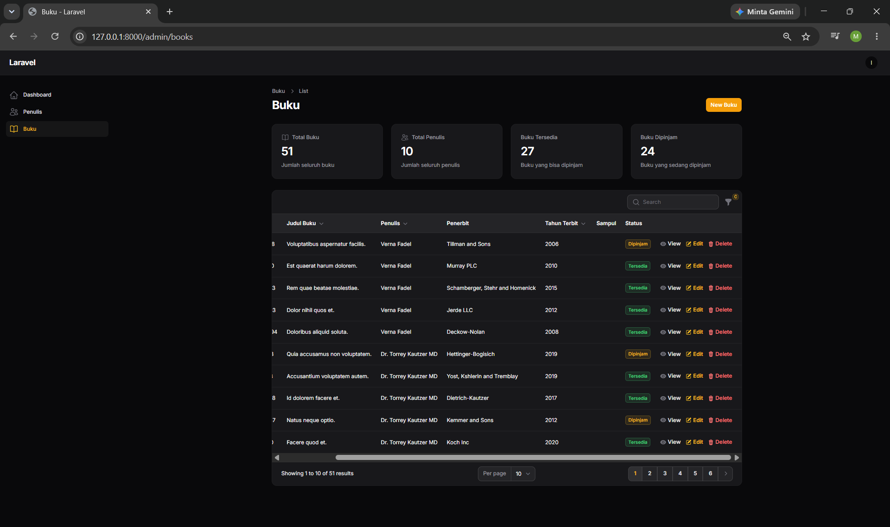

Staff, cuma ada View dan Edit:

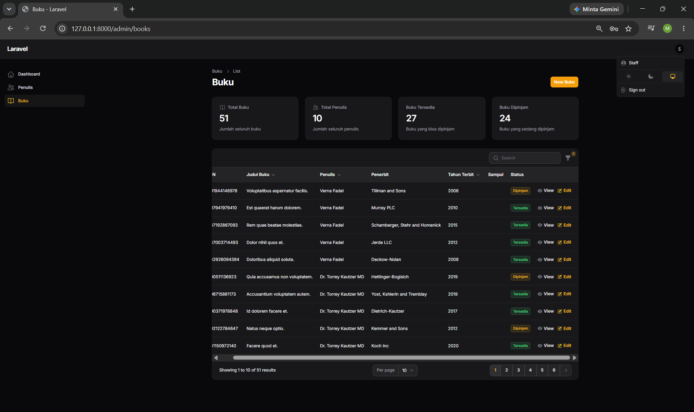

Viewer, cuma ada View dan tidak ada tombol New Buku:

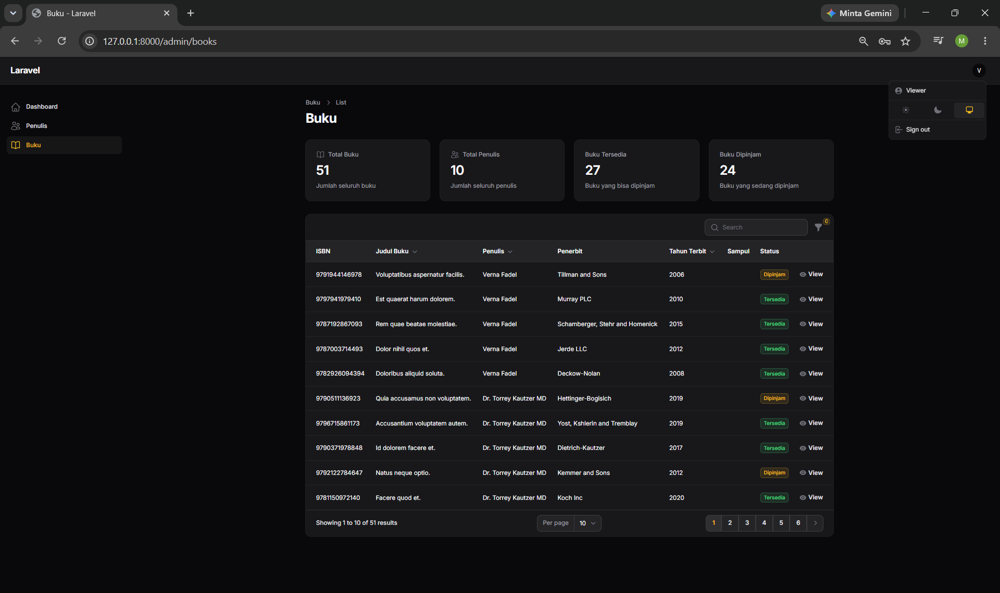

### 3. Widget Dashboard

Ada dua widget. Stats di halaman Buku menampilkan total buku, total penulis, buku tersedia, dan buku dipinjam. Chart donat di Dashboard membandingkan buku tersedia vs dipinjam.

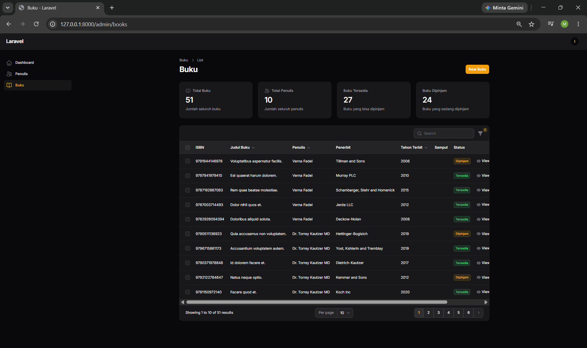

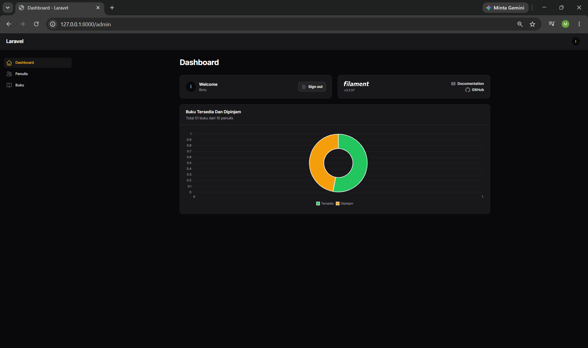

### 4. Kategori Buku

Model `Category` dibuat dan dihubungkan ke Book dengan relasi many-to-many lewat tabel pivot `book_category`. Di form buku, kategori dipilih pakai multiple select, jadi satu buku bisa punya lebih dari satu kategori.

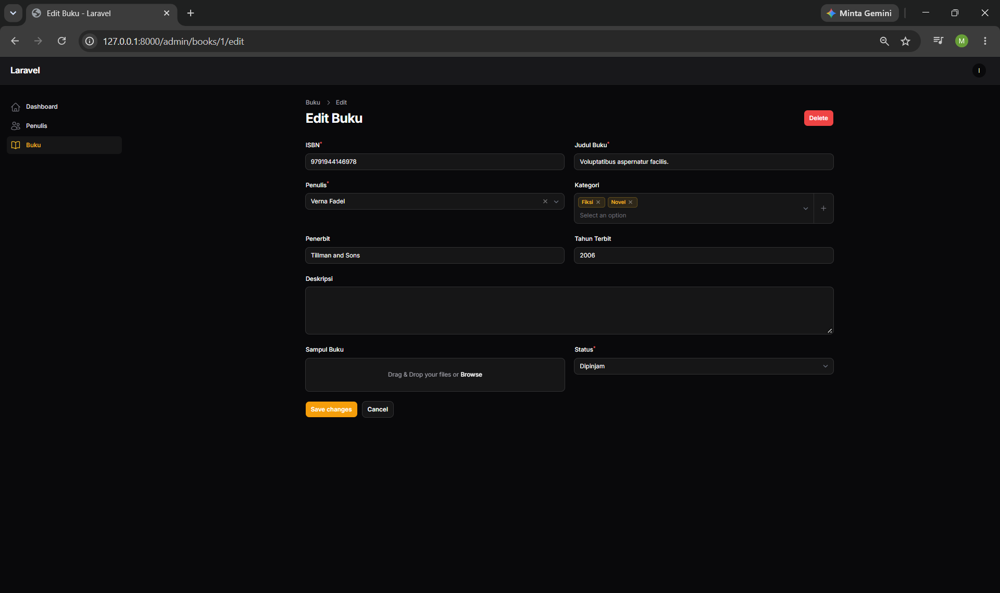

---

## Tugas 3: Analisis dan Dokumentasi

### 1. Penjelasan Arsitektur

#### Diagram ERD

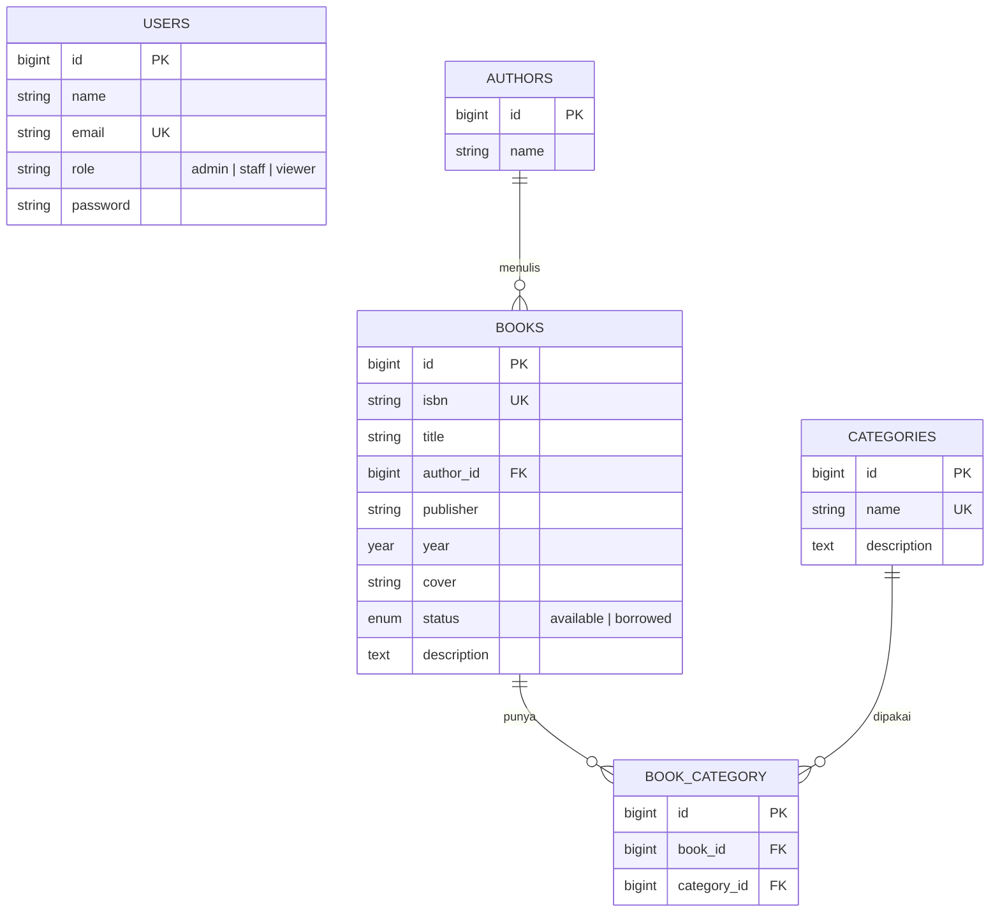

#### Penjelasan relasi antar tabel

- **Authors dan Books (one-to-many).** Satu penulis bisa punya banyak buku, tapi satu buku cuma punya satu penulis. Hubungannya disimpan di kolom `author_id` pada tabel books. Kalau penulis dihapus, bukunya ikut terhapus (cascade).
- **Books dan Categories (many-to-many).** Satu buku bisa masuk beberapa kategori, dan satu kategori bisa berisi banyak buku. Karena itu dipakai tabel pivot `book_category` yang isinya pasangan `book_id` dan `category_id`. Pasangan ini dibuat unique supaya tidak dobel.
- **Users** tidak berelasi ke tabel lain. Kolom `role` dipakai policy untuk menentukan hak akses.

#### Flow aplikasi (dari request hingga response)

Contohnya waktu admin mengedit buku:

1. Browser mengirim request ke `/admin/books/1/edit`. Route-nya otomatis dibuat Filament dari `BookResource`.
2. Request melewati middleware, termasuk pengecekan login. Kalau belum login, diarahkan ke halaman login.
3. Filament mengecek `BookPolicy`, apakah user ini boleh mengedit. Kalau tidak boleh, muncul error 403.
4. Data buku diambil lewat model Eloquent `Book` dari database SQLite, sekalian relasi penulis dan kategorinya.
5. Filament menyusun form dari `BookResource`, lalu hasilnya dikirim ke browser sebagai halaman HTML.
6. Waktu tombol Save diklik, Livewire mengirim data form ke server tanpa reload halaman. Data divalidasi, lalu disimpan ke tabel books dan pivot `book_category`.
7. Server mengirim balik bagian halaman yang berubah dan notifikasi "Saved".

Singkatnya: **Browser → Route → Middleware → Policy → Filament/Livewire → Model → Database → Response**.

### 2. Perbandingan dengan Pendekatan Tradisional

#### CRUD dengan Filament vs manual

Kalau manual, satu CRUD harus bikin route, controller dengan method index/create/store/edit/update/destroy, beberapa view Blade, validasi, pagination, pencarian, filter, dan pengecekan hak akses sendiri-sendiri. Dengan Filament, hampir semua itu cukup ditulis di satu file Resource. Form dan tabel tinggal didefinisikan, sisanya (halaman, tombol, pagination, search, notifikasi) sudah dibuatkan.

#### Kelebihan dan kekurangan

| | Filament | Manual |
|---|---|---|
| **Kelebihan** | Cepat, kodenya sedikit, tampilan sudah rapi, search/filter/upload/widget sudah tersedia, policy langsung terpakai | Bebas atur tampilan dan alur, lebih paham cara kerja Laravel karena ditulis sendiri |
| **Kekurangan** | Tampilan terbatas pada gaya Filament, banyak proses otomatis yang kadang bikin bingung saat ada masalah, beda versi beda cara | Lama, banyak kode berulang, lebih gampang ada yang terlewat (misalnya lupa cek hak akses) |

#### Kapan pakai Filament, kapan tidak

- **Pakai Filament** untuk panel admin, aplikasi yang isinya kebanyakan CRUD (inventaris, perpustakaan, data master), atau proyek yang harus cepat jadi.
- **Tidak pakai Filament** untuk halaman publik yang desainnya harus khusus (landing page, toko online), aplikasi yang alurnya bukan CRUD, atau backend yang cuma menyediakan API untuk aplikasi mobile atau frontend terpisah.

### 3. Refleksi Pembelajaran

#### Apa yang dipelajari

Saya belajar membuat aplikasi CRUD lengkap dengan Laravel dan Filament: migration, model, relasi one-to-many dan many-to-many, factory dan seeder, Resource dengan form, tabel, search, filter, dan upload gambar. Saya juga belajar mengatur hak akses berdasarkan role pakai Policy, membuat widget stats dan chart, dan menyimpan proyek ke GitHub.

#### Kesulitan dan cara mengatasinya

- **Widget tidak muncul.** Ternyata belum dipanggil di halaman yang benar. Akhirnya dipasang lewat `getHeaderWidgets()` di `ListBooks.php`.
- **Bingung struktur folder Filament**, karena `BookResource.php` dan folder `BookResource/` itu berbeda. Diatasi dengan mencocokkan lokasi file dan namespace-nya.
- **Relasi kategori belum jalan**, karena method `categories()` belum tersimpan di `Book.php`. Setelah ditambahkan, multiple select bisa dipakai.
- **Hapus massal masih bisa dipakai staff.** Filament mengecek hapus massal lewat method `deleteAny`, bukan `delete`. Setelah `deleteAny` ditambahkan di policy, hanya admin yang bisa.
- **Takut data hilang waktu menambah tabel baru.** Solusinya pakai migration tambahan dan `php artisan migrate` biasa, bukan `migrate:fresh`.

#### Rencana pengembangan selanjutnya

- Fitur peminjaman buku (siapa yang pinjam, tanggal pinjam dan kembali) supaya status buku berubah otomatis.
- Halaman kelola kategori dan filter buku berdasarkan kategori.
- Hak akses role juga diterapkan ke data penulis.
- Halaman katalog publik supaya pengunjung bisa cari buku tanpa login.
